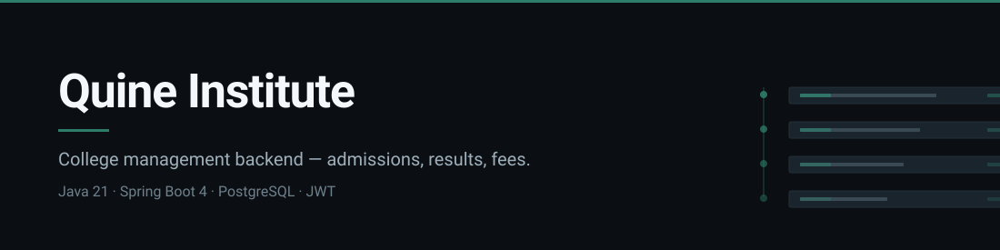
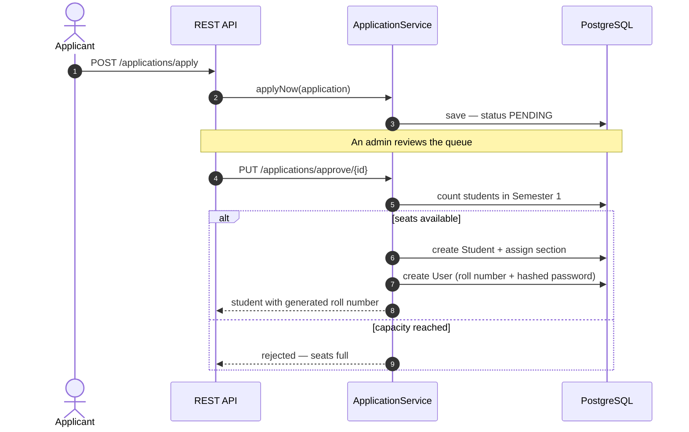
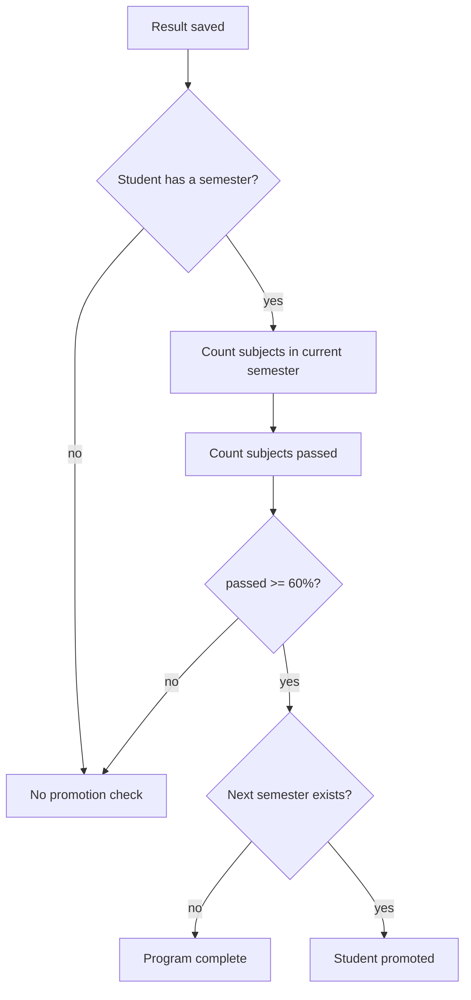
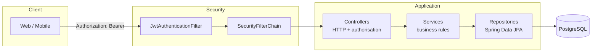
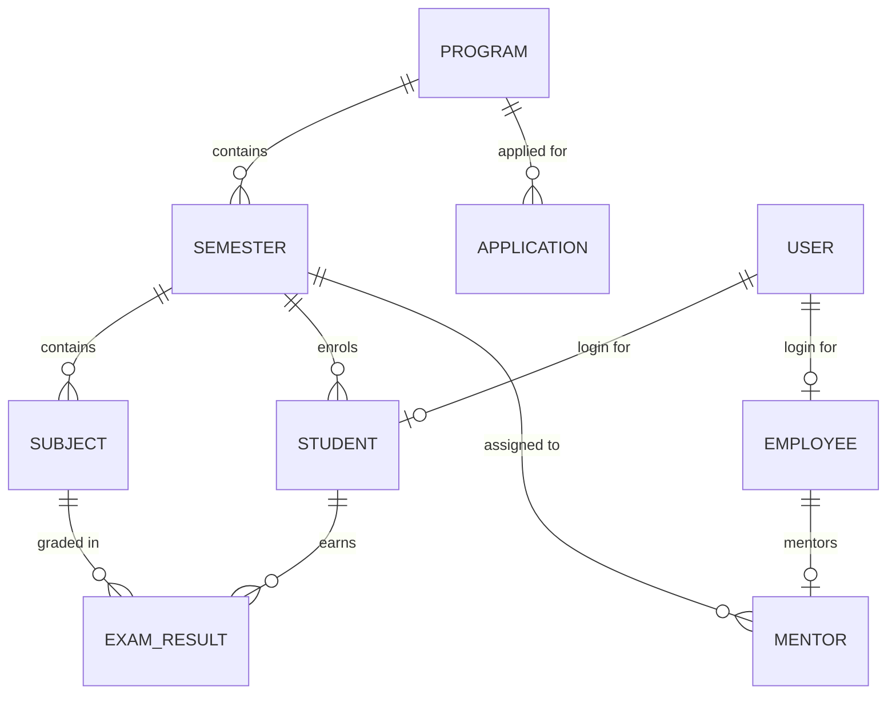

<picture>
  <source media="(prefers-color-scheme: dark)" srcset="docs/banner-dark.svg">
  <source media="(prefers-color-scheme: light)" srcset="docs/banner-light.svg">
  
</picture>

A backend for an academic institution: applicants apply, admins admit them into sections, students sit semester exams, pass a threshold, get promoted, and pay fees — through one REST API secured with JWT and role-based access.


[Quick start](#quick-start) · [How it works](#how-the-rules-work) · [Architecture](#architecture) · [API](#api-reference) · [Roadmap](#status)

---

## What this is

A Spring Boot 4 service on Java 21 and PostgreSQL, built around a real academic hierarchy rather than a set of unrelated tables: `Application → Program → Semester → Subject → ExamResult`. Most of the code exists because those relationships demand it — section allocation, promotion, and a mark sheet that two different roles write to.

**What it is not.** There is no frontend, no payment gateway integration (fee recording is currently a placeholder — see [status](#status)), and no test suite yet. If you need something to deploy in production today, this is not it. If you want to read how an academic domain is modelled in Spring, it is.

**Status.** Active development. Authentication, admissions, student and staff management, the academic hierarchy, exam results with promotion, notices and fee tracking all work end to end. The gaps are listed openly at the bottom.

---

## Quick start

You need **JDK 21** and **PostgreSQL 14 or newer**. Nothing else — the Maven wrapper is committed.

```bash
git clone https://github.com/HiamRyuthere/Quine_Institute_Backend.git
cd Quine_Institute_Backend/backend

createdb quine_db

export SPRING_DATASOURCE_URL=jdbc:postgresql://localhost:5432/quine_db
export SPRING_DATASOURCE_USERNAME=postgres
export SPRING_DATASOURCE_PASSWORD=your_password
export APPLICATION_SECURITY_JWT_SECRET_KEY="$(openssl rand -base64 48)"

./mvnw spring-boot:run
```

**Success looks like this:** the log prints `Started BackendApplication`, and

```bash
curl -s localhost:8080/api/v1/programs
```

returns a JSON array containing the seeded BCA program. First boot creates a demo dataset — six semesters of subjects, an admin, sample students, mentors and notices — so every endpoint is reachable immediately.

The seeded admin credentials live in `DataInitializer`. Change them before this runs anywhere other than your machine.

> The JWT secret must be at least 256 bits for HS256. A shorter key stops the application at startup with `WeakKeyException` — that is Spring telling you the key is guessable, not a bug in the setup.

<details>
<summary><b>Configuration reference</b></summary>

<br>

Every property can be overridden by an environment variable, so no file needs editing:

| Variable | Property | Notes |
|---|---|---|
| `SPRING_DATASOURCE_URL` | `spring.datasource.url` | JDBC URL |
| `SPRING_DATASOURCE_USERNAME` | `spring.datasource.username` | |
| `SPRING_DATASOURCE_PASSWORD` | `spring.datasource.password` | |
| `APPLICATION_SECURITY_JWT_SECRET_KEY` | `application.security.jwt.secret-key` | ≥ 32 bytes |

</details>

---

## The task most people open this for

An applicant submits a form with no account. An admin approves it. The system then does four things at once: creates the student, generates a roll number, assigns a section by capacity, and issues a login.

```bash
# public — no token needed
curl -X POST localhost:8080/api/v1/applications/apply \
  -H 'Content-Type: application/json' \
  -d '{"name":"A. Student","email":"a@example.com","mobileNumber":"9000000000","percentage":78.4,"program":{"id":1}}'

# admin — approve, and the student is created
curl -X PUT localhost:8080/api/v1/applications/approve/1 \
  -H "Authorization: Bearer $TOKEN"
```



---

## How the rules work

Three pieces of logic carry the project. Each is short enough to read in the source, and each is here because a naive implementation gets it wrong.

<details>
<summary><b>Section allocation without a Section table</b> — why there is no section entity</summary>

<br>

Program capacity is split into quarters and the count of students already enrolled decides the bucket:

```java
int sectionSize = programCapacity / 4;
if      (currentCount < sectionSize)     section = ALPHA;
else if (currentCount < sectionSize * 2) section = BETA;
else if (currentCount < sectionSize * 3) section = GAMA;
else                                     section = DELTA;
```

A `Section` table would store four rows per program and buy nothing — a section has no attributes of its own here. The trade-off is that changing the number of sections means changing code, and a capacity not divisible by four leaves a remainder that currently falls into `DELTA`.

</details>

<details>
<summary><b>Promotion at 60%</b> — and why ExamResult has no semester column</summary>

<br>



The current term is derived by walking `result → subject → semester` rather than being copied onto the result. That keeps the schema normalised and makes a result impossible to attribute to the wrong term. The cost is a join on every promotion check.

</details>

<details>
<summary><b>Two roles, one mark sheet</b> — how faculty and examiners stay apart</summary>

<br>

`ExamResult` holds `internalMarks` and `externalMarks` separately, and each role may write only its own half. Pass/fail is never stored from input — the service computes it from the total at a 33-mark boundary:

```java
int total = internal + external;
result.setStatus(total < 33 ? "FAIL" : "PASS");
```

Splitting the columns rather than the rows means a single result record survives both roles writing to it, with no merge step.

</details>

---

## Architecture



The layering is strict: controllers handle HTTP and authorisation, services own business rules, repositories are the only layer that touches the database.

<details>
<summary><b>Data model</b></summary>

<br>



</details>

<details>
<summary><b>Project layout</b></summary>

<br>

```
backend/src/main/java/com/quine/backend/
├── config/        SecurityFilterChain, CORS, first-run seed data
├── security/      JWT generation, claims, request filter
├── controller/    11 REST controllers — HTTP and authorisation only
├── service/       Business rules: admission, promotion, notices, fees
├── repository/    11 Spring Data JPA interfaces
├── model/         12 entities and 2 enums
└── dto/           Request and response payloads
```

</details>

---

## API reference

Base path `/api/v1`. JSON in, JSON out. Protected routes need `Authorization: Bearer <token>`.

Access is written as **ADMIN**, **FACULTY**, **EXAMINER**, **STUDENT**, **STAFF**, `token` (any authenticated user) or `public`.

<details>
<summary><b>Authentication</b> — 2 endpoints</summary>

<br>

| Method | Endpoint | Access | Description |
|:--:|---|:--:|---|
| `POST` | `/auth/login` | public | Returns a JWT with the caller's role and display name |
| `POST` | `/auth/change-password` | token | Change the logged-in user's password |

```jsonc
// POST /api/v1/auth/login
{ "username": "100001", "password": "••••••" }

// 200
{ "message": "Login Successful!", "token": "eyJhbGciOiJIUzI1NiJ9...",
  "role": "STUDENT", "username": "100001", "name": "Student Name" }
```

</details>

<details>
<summary><b>Admissions</b> — 3 endpoints</summary>

<br>

| Method | Endpoint | Access | Description |
|:--:|---|:--:|---|
| `POST` | `/applications/apply` | public | Submit an admission application |
| `GET` | `/applications/pending` | ADMIN | Applications awaiting review |
| `PUT` | `/applications/approve/{id}` | ADMIN | Approve — creates student, section and login |

</details>

<details>
<summary><b>Students</b> — 3 endpoints</summary>

<br>

| Method | Endpoint | Access | Description |
|:--:|---|:--:|---|
| `POST` | `/students` | ADMIN | Enrol a student; generates roll number and login |
| `GET` | `/students` | ADMIN, FACULTY | List all students |
| `GET` | `/students/{studentId}` | token | By roll number — a student may read only their own |

</details>

<details>
<summary><b>Academics</b> — 8 endpoints</summary>

<br>

| Method | Endpoint | Access | Description |
|:--:|---|:--:|---|
| `POST` | `/programs` | ADMIN | Create a program |
| `GET` | `/programs` | public | List programs |
| `POST` | `/semesters` | ADMIN | Create a semester |
| `GET` | `/semesters` | token | List semesters |
| `GET` | `/semesters/{id}` | token | One semester |
| `POST` | `/subjects` | ADMIN | Create a subject |
| `GET` | `/subjects` | token | List subjects |
| `GET` | `/subjects/program/{programId}` | token | Subjects under a program |

</details>

<details>
<summary><b>Examination</b> — 2 endpoints</summary>

<br>

| Method | Endpoint | Access | Description |
|:--:|---|:--:|---|
| `POST` | `/results/add` | ADMIN, FACULTY, EXAMINER | Record marks; computes PASS/FAIL, runs promotion |
| `GET` | `/results/student/{studentId}` | token | Every result for one student |

</details>

<details>
<summary><b>Staff and mentoring</b> — 5 endpoints</summary>

<br>

| Method | Endpoint | Access | Description |
|:--:|---|:--:|---|
| `POST` | `/employees` | ADMIN | Create an employee; a login is issued |
| `GET` | `/employees` | ADMIN, FACULTY | List employees |
| `GET` | `/employees/{id}` | token | One employee |
| `POST` | `/mentors` | ADMIN | Assign a mentor to a semester and section |
| `GET` | `/mentors/find` | token | By `semesterId` and `section` |

</details>

<details>
<summary><b>Notices and fees</b> — 5 endpoints</summary>

<br>

| Method | Endpoint | Access | Description |
|:--:|---|:--:|---|
| `POST` | `/notices` | ADMIN | Publish — auto-archives after its execution date |
| `GET` | `/notices` | public | Active notices |
| `GET` | `/notices/archive` | public | Archived notices |
| `GET` | `/payments/status/{studentId}` | token | Total, paid and remaining fees |
| `POST` | `/payments/verify` | token | Record a fee payment |

</details>

---

## Roles

| Role | Scope | Can do |
|---|---|---|
| ADMIN | Institution | Admissions, students, employees, programs, semesters, subjects, mentors, notices |
| FACULTY | Teaching | View students and employees, enter internal marks, find mentors |
| EXAMINER | Examination | Enter external marks |
| STAFF | Support | Read academic data |
| STUDENT | Self | Own profile, own results, fee status, notices |

Two rules sit below the URL level: a student may fetch only their own roll number, and faculty and examiners are separated by which column of a mark sheet they may write rather than by which route they can reach.

---

## Status

Active development. Honest list of what is missing, roughly in the order it matters:

| Item | Why it matters |
|---|---|
| Server-side payment verification | The fee endpoint trusts a client-supplied value. It needs a gateway signature check and an idempotent `Payment` record before it can handle real money. |
| DTO layer and request validation | Entities are accepted on the wire today. `@Valid` with constraints belongs on request DTOs. |
| Transactional service methods | Approval and enrolment write to several tables and should be atomic. |
| Role checks from the security context | Faculty and examiner permissions must come from the token, never from a request parameter. |
| Auth route scoping | `/auth/change-password` should sit behind authentication rather than inside the public `/auth/**` matcher. |
| Test coverage | Unit tests for promotion and section allocation, Testcontainers for repositories. |
| Pagination | Every list endpoint returns the full table today. |
| Flyway migrations | `ddl-auto=update` is convenient and unversioned. |

---

## Contributing

Keep the layering intact — controllers never touch repositories, and business rules live in services — and run the build before opening a pull request.

```bash
git checkout -b feature/your-feature
./mvnw verify
```

---

## License

MIT — see [LICENSE](LICENSE).

Built by [Harsh Parmar](https://www.linkedin.com/in/hiamharsh), Indore, India.
